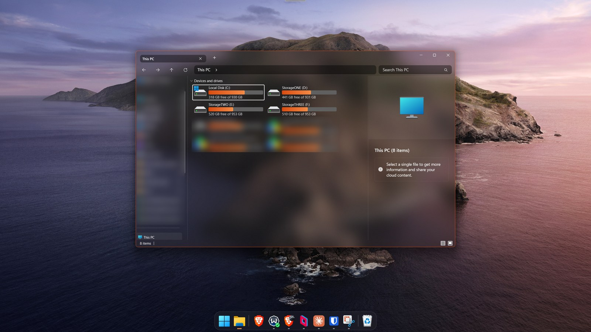
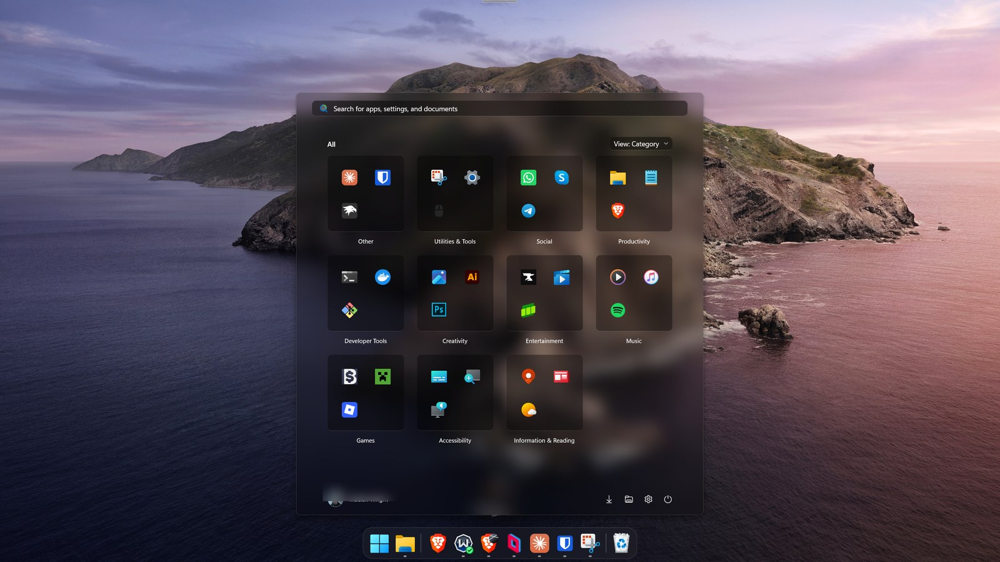
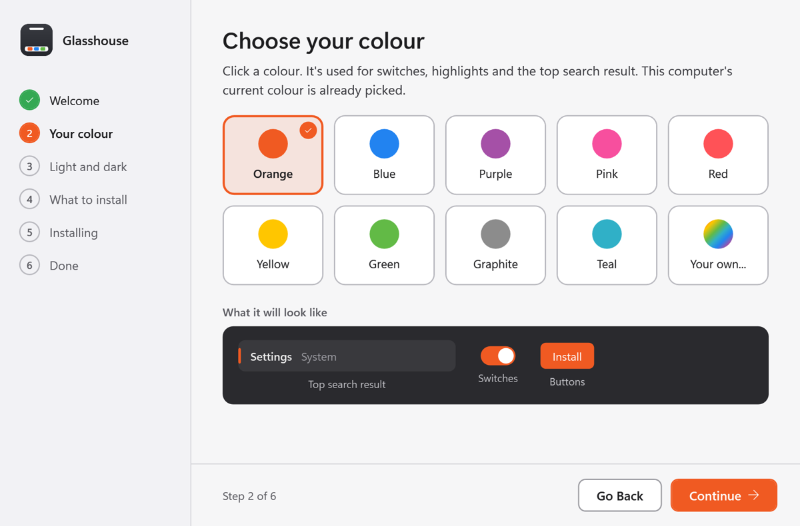
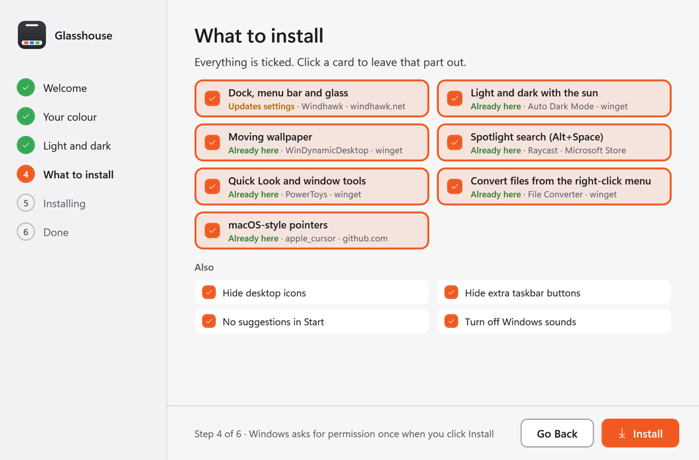

# Glasshouse

[](https://github.com/maclanwright/glasshouse/releases/latest)
[](https://github.com/maclanwright/glasshouse/releases)

[](LICENSE)

**Make Windows 11 look and feel like macOS in about five minutes, without editing a single setting by hand.**

Download one file, pick your colour, click Install. Glasshouse sets up a Dock, a menu bar, frosted glass, matching themes and light-by-day, dark-by-night switching, then gives you a simple settings window to fine-tune it all. Change your mind? Everything can be switched off again.



## Why Glasshouse

Getting this look by hand means installing half a dozen tools, finding the right mods and themes, and tuning hundreds of settings so they don't clash. Glasshouse does all of that in one go:

- **One installer, no fiddling.** Choose a colour and how light and dark should switch. That's it.
- **Nothing bundled, nothing hidden.** Every tool downloads from its own official source while you install, and the code is open for anyone to read.
- **It keeps working.** Repair puts everything back if a Windows update or another app changes something.
- **Share your setup.** Save your look as one small file and send it to a friend.

## What you get

- **A Dock** that hides at the bottom of the screen and magnifies as you move over it
- **A menu bar** at the top: clock, control centre, notifications and your tray icons, in one pill
- **Frosted glass** on Windows' own windows (File Explorer, Task Manager, Control Panel and the rest). Apps you install keep their own design.
- **Themes** for Start, search, File Explorer, Settings and the notification panels
- **Light by day, dark at night**, following the sun where you are, with a dynamic wallpaper that changes through the day
- **macOS-style pointers**
- **Spotlight-style search** (Raycast, Alt+Space), **Quick Look** and window tools (PowerToys), and **file conversion** from the right-click menu (File Converter)



Everything is optional. The installer lets you untick any part.

## Install

1. Download `Glasshouse.exe` from [Releases](../../releases).
2. Double-click it. The installer asks for your colour, how light and dark should switch, and which parts you want. Windows asks for permission once when you click Install.
3. When it's done, open **Glasshouse** from the Start menu to change anything.




**Windows will warn you about the download.** Glasshouse isn't signed with a paid certificate, so SmartScreen shows "Windows protected your PC": click **More info**, then **Run anyway**. If **Smart App Control** is on (Windows Security > App & browser control), Windows may block Glasshouse and the Windhawk mods that make the Dock, menu bar and glass; the rest works either way. You can always build it yourself instead (below).

## Works on

| | |
|---|---|
| **Windows** | Windows 11 (tested on Home 25H2 and 26H2). Windows 10 isn't supported: the themes only exist for Windows 11. |
| **PCs** | Regular Intel and AMD PCs, laptops and desktops. ARM laptops (Snapdragon) haven't been tested. |
| **Screens** | One or more screens, any size or scaling (tested on two 1440p screens and a 175% scaled laptop screen). |
| **You need** | An admin account (Windows asks once), an internet connection while installing, and about 5 minutes. |
| **Not tested** | Pro and Enterprise editions (should work), work or school PCs (their rules may block it), Windows in languages other than English. |

## Is it safe?

- It's **open source**: every line is here to read, and you can build it yourself.
- It only installs **well-known free tools** ([Windhawk](https://windhawk.net), Microsoft PowerToys, Auto Dark Mode and others, listed under Credits), each from its official source.
- It asks for admin permission **once**, to install Windhawk and its mods.
- It changes appearance settings only: no files are deleted and nothing runs in the background except the tools you chose.
- You can **undo** it: switch any part off in the settings window, or uninstall (see below).

## The settings window

Glasshouse opens as a small settings window, laid out like macOS System Settings:

- **Appearance**: accent colour, light and dark times, wallpaper
- **Dock**, **Menu bar**, **Window previews**, **Glass and hover**: sizes, blur and tint, with changes shown live
- **Pointers and apps**: pointers, desktop tidy-ups, Task Manager kept dark
- **Look files**: save your whole setup to one file, or open someone else's
- **Repair**: puts everything back the way your look says, if a Windows update or another app changes something
- **Inspector**: takes a picture of a part of Windows with every piece outlined and named, for anyone who wants to restyle it further

## Look files

A `.glasshouse` file is plain JSON holding your colour, light and dark settings, wallpaper, tidy-ups and every mod's settings. Opening one on another computer applies it there. Bits that only make sense on the computer they came from (for example hiding Parsec's helper button) stay off unless you turn them on.

Themes from the Windhawk styling guides are stored as a link to their page and read from there when the look is applied, so look files never carry copies of other people's work.

## Questions

**Will it slow my PC down?** The tools are small and mostly idle. The glass and the Dock use your graphics card the way Windows' own effects do.

**Does it affect games?** No. Full-screen games cover the Dock and menu bar, and the glass only applies to Windows' own windows, not games or apps you install.

**What happens when Windows updates?** Usually nothing. If an update undoes a setting, open Glasshouse and click **Repair**.

**Can I keep my own wallpaper or colour?** Yes. Both are choices in the installer and can be changed any time.

**Is this affiliated with Apple?** No. It's a free fan project.

## How it works

Most of the look comes from [Windhawk](https://windhawk.net) mods. Glasshouse installs Windhawk with winget, downloads each mod's published build from windhawk.net (or a fixed build, see [Fixes to mods](#fixes-to-mods)), and writes its settings, the same way Windhawk's own window would. Apps come from winget or the Microsoft Store.

A few safety rules are built in:

- The window glass only loads into Windows' own programs: never into apps you install, Glasshouse itself, Windows' background services, or network services such as VPNs (Tailscale), where it can cause crashes or garbled text.
- If the glass mod ever has to reload while such a service is running with it loaded, Glasshouse stops the service, makes the change and starts it again.
- New mods are written switched off and turned on only once their settings are in place.

## Fixes to mods

When a mod has a bug its author hasn't fixed yet, Glasshouse installs a fixed build of the same version instead: the author's code with a small change, built with Windhawk's own compiler and published on the [mod-fixes release](https://github.com/maclanwright/glasshouse/releases/tag/mod-fixes). Each download is checked against its hash before it's installed, and Repair puts the fixed build back if the author's one is installed. The changes are in [`fixes`](fixes) and keep the mod's own licence (GPL-3.0). Windhawk still offers the author's updates as usual.

| Mod | Version | What the fix does |
|---|---|---|
| Mac Island & Dock | 2.0.1 | Bluetooth list: a device you click no longer stays on "Connecting..." for good (which also blocked every other click in the list), and Disconnect disconnects headphones fully, music and calls, like Windows' own button. |

## Uninstalling

Glasshouse itself: Windows Settings > Apps > Installed apps > Glasshouse > Uninstall. This removes the Glasshouse program and its helper task. The tools it installed (Windhawk and its mods, Auto Dark Mode, WinDynamicDesktop, PowerToys, Raycast, File Converter) stay until you uninstall them the same way, because you may want to keep some of them.

## Building it yourself

Glasshouse is a single C# WPF program for .NET Framework 4.8, which is part of Windows, so the finished `.exe` runs with nothing else installed. To build it you need the .NET SDK:

```
dotnet build -c Release
```

The program is `bin\Release\Glasshouse.exe`.

## Credits

Glasshouse only puts these together. All the hard work is theirs.

| Part | By |
|---|---|
| [Windhawk](https://windhawk.net) | [m417z](https://github.com/m417z) and contributors |
| MacOS Style Dock (mod) | [Zach Vaughn](https://github.com/zachvdev) |
| Mac Island & Dock (menu bar mod) | [caliberda](https://github.com/cesarkali) |
| Windows 11 Taskbar, Start Menu, File Explorer, Notification Center and Settings Stylers, Taskbar Thumbnail Size (mods) | [m417z](https://github.com/m417z) |
| Translucent Windows (mod) | [Undisputed00x](https://github.com/Undisputed00x) |
| Spoof Light/Dark Theme (mod) | [aubymori](https://github.com/aubymori) |
| Explorer Navigation Tree Offset (mod) | [Languster](https://github.com/Languster) |
| Press Esc to exit Task Manager (mod) | [chenxustu1](https://github.com/chenxustu1) |
| LiquidGlass themes for Start, File Explorer and notifications | [PhantomNimbi](https://github.com/PhantomNimbi) |
| Translucent Seamless theme for Settings | [ArvindSaini978](https://github.com/ArvindSaini978), based on Translucent Settings11 by [Link Vegas](https://github.com/linkvegas12) |
| [Auto Dark Mode](https://github.com/AutoDarkMode/Windows-Auto-Night-Mode) | Armin Osaj and contributors |
| [WinDynamicDesktop](https://github.com/t1m0thyj/WinDynamicDesktop) and its Catalina theme | t1m0thyj |
| [apple_cursor](https://github.com/ful1e5/apple_cursor) (pointers) | ful1e5 |
| [PowerToys](https://github.com/microsoft/PowerToys) | Microsoft |
| [File Converter](https://github.com/Tichau/FileConverter) | Tichau |
| [Raycast](https://www.raycast.com) | Raycast |

macOS is a trademark of Apple Inc. Glasshouse isn't affiliated with or endorsed by Apple.

## Licence

Glasshouse's own code is under the [MIT licence](LICENSE). Every tool it installs keeps its own licence.
