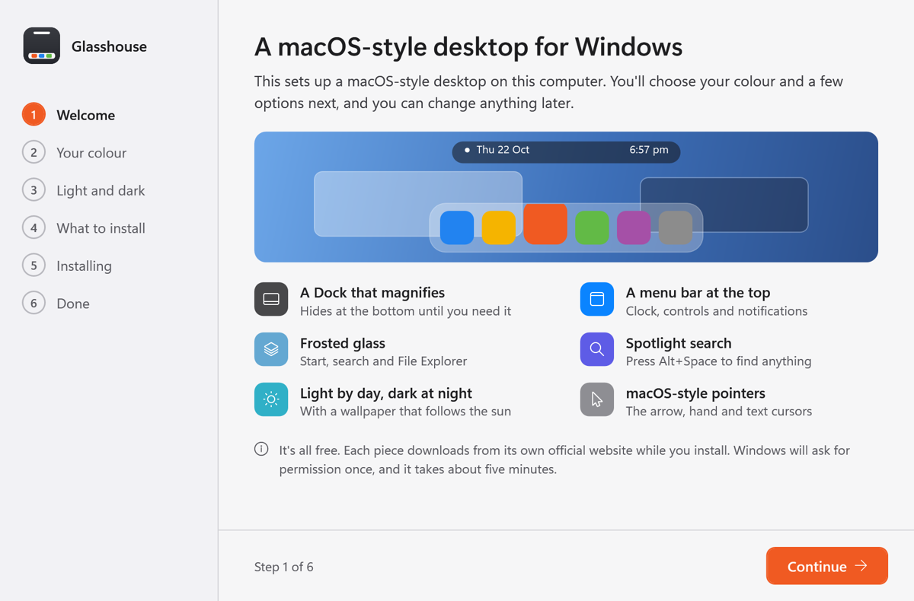

# Glasshouse

A macOS-style desktop for Windows 11, set up by one small program.

Glasshouse installs a set of free, open tools, configures them to work together, and gives you one simple settings window to adjust the result. You can save your setup as a look file and give it to someone else. Every tool is downloaded from its own official source while you install. Nothing is bundled.



## What you get

- **A Dock** that hides at the bottom of the screen and magnifies as you move over it
- **A menu bar** at the top: clock, control centre, notifications and your tray icons, in one pill
- **Frosted glass** on Windows' own windows (File Explorer, Task Manager, Control Panel and the rest). Apps you install keep their own design.
- **Themes** for Start, search, File Explorer, Settings and the notification panels
- **Light by day, dark at night**, following the sun where you are, with a dynamic wallpaper that changes through the day
- **macOS-style pointers**
- **Spotlight-style search** (Raycast, Alt+Space), **Quick Look** and window tools (PowerToys), and **file conversion** from the right-click menu (File Converter)

Everything is optional. The installer lets you untick any part.

## Install

1. Download `Glasshouse.exe` from [Releases](../../releases).
2. Double-click it. The installer asks for your colour, how light and dark should switch, and which parts you want. Windows asks for permission once when you click Install.
3. When it's done, open **Glasshouse** from the Start menu to change anything.


**Windows will warn you about the download.** Glasshouse isn't signed with a paid certificate, so SmartScreen shows "Windows protected your PC": click **More info**, then **Run anyway**. If **Smart App Control** is on (Windows Security > App & browser control), Windows may block Glasshouse and the Windhawk mods that make the Dock, menu bar and glass; the rest works either way. You can always build it yourself instead (below).

Needs Windows 11 and an internet connection while installing.

## The settings window

Glasshouse opens as a small settings window, laid out like macOS System Settings:

- **Appearance**: accent colour, light and dark times, wallpaper
- **Dock**, **Menu bar**, **Window previews**, **Glass and hover**: sizes, blur and tint, with changes shown live
- **Pointers and apps**: pointers, desktop tidy-ups, Task Manager kept dark
- **Look files**: save your whole setup to one file, or open someone else's
- **Repair**: puts everything back the way your look says, if a Windows update or another app changes something
- **Inspector**: takes a picture of a part of Windows with every piece outlined and named, for anyone who wants to restyle it further

## Look files

A `.glasshouse` file is plain JSON holding your colour, light and dark settings, wallpaper, tidy-ups and every mod's settings. Opening one on another computer applies it there. Bits that only make sense on the computer they came from (for example hiding Parsec's helper button) stay off unless you turn them on.

Themes from the Windhawk styling guides are stored as a link to their page and read from there when the look is applied, so look files never carry copies of other people's work.

## How it works

Most of the look comes from [Windhawk](https://windhawk.net) mods. Glasshouse installs Windhawk with winget, downloads each mod's published build from windhawk.net, and writes its settings, the same way Windhawk's own window would. Apps come from winget or the Microsoft Store.

A few safety rules are built in:

- The window glass only loads into Windows' own programs: never into apps you install, Glasshouse itself, Windows' background services, or network services such as VPNs (Tailscale), where it can cause crashes or garbled text.
- If the glass mod ever has to reload while such a service is running with it loaded, Glasshouse stops the service, makes the change and starts it again.
- New mods are written switched off and turned on only once their settings are in place.

## Uninstalling

Glasshouse itself: Windows Settings > Apps > Installed apps > Glasshouse > Uninstall. This removes the Glasshouse program and its helper task. The tools it installed (Windhawk and its mods, Auto Dark Mode, WinDynamicDesktop, PowerToys, Raycast, File Converter) stay until you uninstall them the same way, because you may want to keep some of them.

## Building it yourself

Glasshouse is a single C# WPF program for .NET Framework 4.8, which is part of Windows, so the finished `.exe` runs with nothing else installed. To build it you need the .NET SDK:

```
dotnet build -c Release
```

The program is `bin\Release\Glasshouse.exe`.

## Credits

Glasshouse only puts these together. All the hard work is theirs.

| Part | By |
|---|---|
| [Windhawk](https://windhawk.net) | [m417z](https://github.com/m417z) and contributors |
| MacOS Style Dock (mod) | [Zach Vaughn](https://github.com/zachvdev) |
| Mac Island & Dock (menu bar mod) | [caliberda](https://github.com/cesarkali) |
| Windows 11 Taskbar, Start Menu, File Explorer, Notification Center and Settings Stylers, Taskbar Thumbnail Size (mods) | [m417z](https://github.com/m417z) |
| Translucent Windows (mod) | [Undisputed00x](https://github.com/Undisputed00x) |
| Spoof Light/Dark Theme (mod) | [aubymori](https://github.com/aubymori) |
| Explorer Navigation Tree Offset (mod) | [Languster](https://github.com/Languster) |
| Press Esc to exit Task Manager (mod) | [chenxustu1](https://github.com/chenxustu1) |
| LiquidGlass themes for Start, File Explorer and notifications | [PhantomNimbi](https://github.com/PhantomNimbi) |
| Translucent Seamless theme for Settings | [ArvindSaini978](https://github.com/ArvindSaini978), based on Translucent Settings11 by [Link Vegas](https://github.com/linkvegas12) |
| [Auto Dark Mode](https://github.com/AutoDarkMode/Windows-Auto-Night-Mode) | Armin Osaj and contributors |
| [WinDynamicDesktop](https://github.com/t1m0thyj/WinDynamicDesktop) and its Catalina theme | t1m0thyj |
| [apple_cursor](https://github.com/ful1e5/apple_cursor) (pointers) | ful1e5 |
| [PowerToys](https://github.com/microsoft/PowerToys) | Microsoft |
| [File Converter](https://github.com/Tichau/FileConverter) | Tichau |
| [Raycast](https://www.raycast.com) | Raycast |

macOS is a trademark of Apple Inc. Glasshouse isn't affiliated with or endorsed by Apple.

## Licence

Glasshouse's own code is under the [MIT licence](LICENSE). Every tool it installs keeps its own licence.
